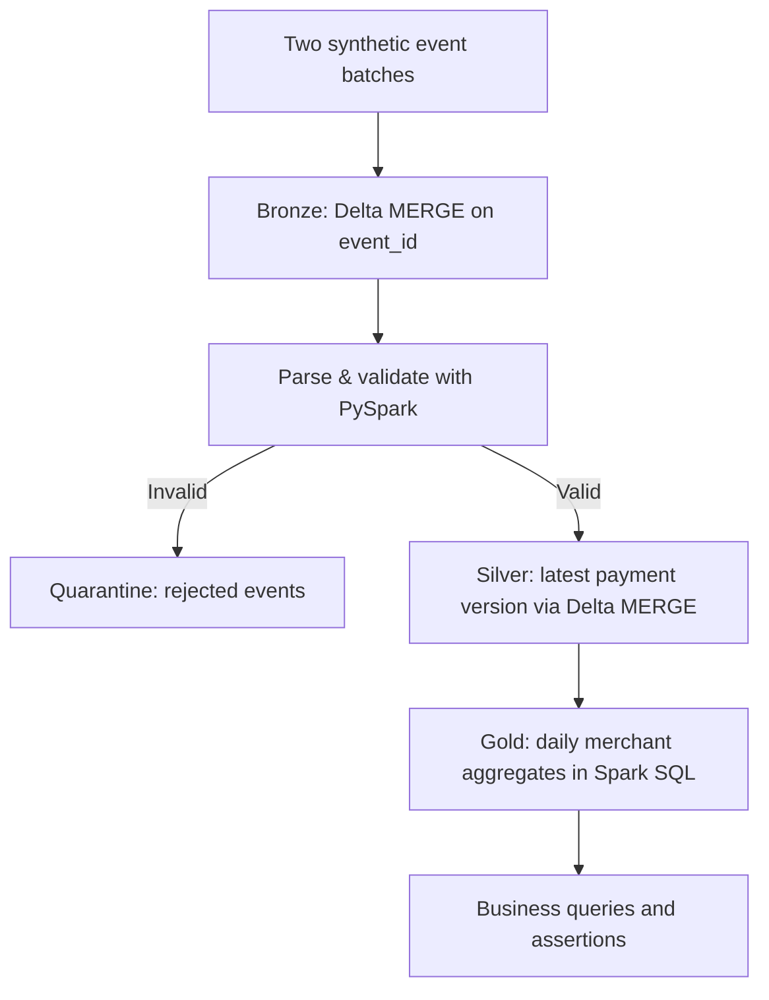

# Architecture and contracts

## Business grain and ordering
- Bronze: one row per transport-level `event_id`, preserving original source text; exact event replay does not insert.
- Silver: one current-state row per `payment_id`. Larger `event_version` wins. Equal version uses later `event_ts`. A tie in both is resolved deterministically by event ID *within a batch*, but cross-batch equal-version conflicts are not yet quarantined.
- Gold: one row per (`business_date`, `merchant_id`), date derived from event timestamp in the Databricks session time zone (serverless default UTC).
- Failure counts reflect **current failed payment states**, not the cumulative number of failed event attempts.
- Invalid source events are rejected before Silver, not silently skipped.

## Current implementation constraints
- Embedded fixture rows are used in notebook M1, not ingested from the included CSV files. File/volume-backed ingestion is a follow-up.
- Source key `event_id` must be non-null and unique within an input batch.
- Bronze MERGE does not check for mutated payloads with the same event ID.
- Only positive payment snapshots with `SETTLED`/`FAILED` statuses are accepted. This is a deliberate simplified model; refunds/chargebacks have different rules.
- Silver is incrementally updated by batch; Gold uses full-table replacement until incremental aggregate retractions are implemented.
- No operational workflow, access controls, monitoring, production SLA or real bank data is included in M1.
