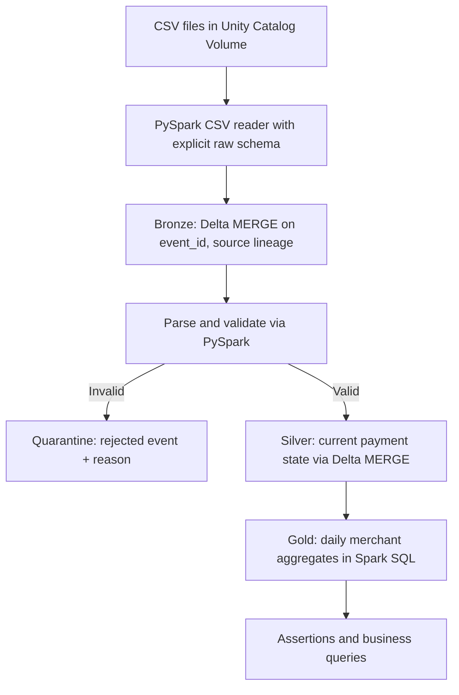

# Architecture and data contracts

M1 uses equivalent embedded fixtures and the table names `bronze_transactions`, `silver_payments`, `quarantine_events`, `gold_daily_payments`. M2 reads files from a governed volume and uses dedicated `*_file_*` tables to preserve M1 evidence.

## Grains and contracts
- Bronze: one committed event ID, with raw strings, file path and ingestion timestamp. Events with the same ID and changed payload are rejected at file ingress in M2.
- Silver: one current-state row per `payment_id`, based on the largest `event_version`, then latest `event_ts`. Equal-version/timestamp conflicts across batches have an unresolved collision policy; don't claim fully deterministic conflict handling yet.
- Gold: one `(business_date, merchant_id)` row, based on the latest Silver state and event date. Amount is `DECIMAL(18,2)`.
- Failure count means currently failed payment states, not count of all failed attempts.
- Quarantine: invalid source values and their reason, no silent drops.

## Implementation scope
M2 uses manual volume uploads, file-by-file batch execution and Delta MERGE, with whole-batch reprocessing of committed Bronze for retry safety. Gold is rebuilt rather than incrementally patched because corrections can move payments between dates and statuses. Later milestones will add reconciliation and a tested failure-recovery scenario, then Databricks Jobs orchestration. No bank integration, production deployment, scheduling, or streaming is yet demonstrated.
